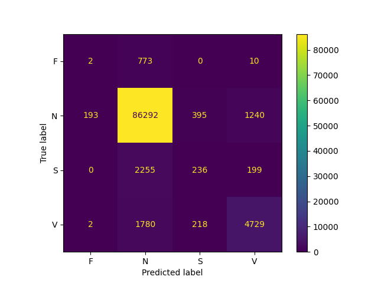

# ECG Arrhythmia Classifier

A beat-level ECG pipeline on the MIT-BIH Arrhythmia Database, validated against ANSI/AAMI EC57, where per-record analysis found failures that a 97.6% aggregate sensitivity hides: a reversed lead on record 114, and a QRS detector on record 228 that keeps 82% of ventricular beats while discarding 96% of normal ones.

The pipeline runs end to end: filtering, a from-scratch Pan-Tompkins detector, wavelet and RR-interval features, and a Random Forest classifier evaluated with patient-wise cross-validation. The classifier handles ventricular beats reasonably and fails on supraventricular beats. Its known and suspected causes are documented below.

> **Status: scoped and complete.** The detector has been validated against EC57 across all 48 records, and every defect found has been either fixed or quantified and documented. The largest known defect, beat-window contamination, was measured but deliberately left unfixed to keep the project in scope. Remaining work is listed in the [Roadmap](#roadmap).

---

## Headline results

| | Result |
|---|---|
| Detector, gross Se / +P (44 non-paced records, 100,733 beats) | **97.63% / 99.52%** |
| Detector, average-of-records Se / +P | 97.48% / 99.47% |
| Annotation reconciliation | 109,494 beats, matching the published MIT-BIH total exactly |
| Classifier, 5-fold patient-wise CV macro F1 (F, N, S, V) | 0.455 ± 0.046 |
| Classifier, V sensitivity / +P | 70.3% / 76.5% |
| Classifier, S sensitivity / +P | **8.8%** / 27.8% |

---

## How the project developed

The classifier came first. Its results were poor for the minority classes, especially S and F, and adding P-wave features and SMOTE oversampling barely moved them. Instead of continuing to tune the model, I traced the problem upstream. That revealed that the R-peak detector feeding the classifier had never been validated against ground truth, so the detector was validated against EC57, record by record, before trusting any classifier result. That work found the annotation-parsing error, the lead reversal on record 114, the population failure on record 228, and the beat-window contamination described below.

The contamination is likely a significant contributor to the poor classifier results. It was quantified and its mechanism confirmed, but fixing it properly means redesigning segmentation and the feature matrix, so it was left out of scope and is documented as a limitation.

---

## Dataset

[MIT-BIH Arrhythmia Database](https://physionet.org/content/mitdb/1.0.0/): 48 half-hour two-lead recordings from 47 subjects at 360 Hz, with expert beat-by-beat annotations. Accessed via `wfdb`. Data is not tracked in this repo.

```python
import wfdb
wfdb.dl_database('mitdb', dl_dir='data/mitdb')
```

### Annotation handling

Raw WFDB annotation files mix genuine beat labels with non-beat markers (rhythm changes, signal-quality flags, comments, flutter boundaries). Counting these as beats inflates apparent detector miss rates.

An `AAMI_MAP` dictionary maps the 15 genuine beat symbols (`N L R e j A a J S V E F / f Q`) to the five AAMI classes, and every other symbol is filtered out before any count comparison.

After filtering, the summed beat count across all 48 records is **109,494, matching the published MIT-BIH total exactly**. The stripped non-beat annotations total 3,153, independently matching the discrepancy seen before the correction.

This correction changed the picture substantially. Record 231 contained 427 comment annotations, each previously counted as a missed beat; its apparent miss rate fell from 21.9% to 0.1% once they were filtered. Records 219, 200 and 222 showed similar collapses. Much of the early "detector problem" was an annotation-parsing problem.

### Record handling

- **Lead selection by name.** The pipeline selects the MLII lead by its `sig_name` rather than assuming channel 0. A sweep of all 48 records found three that do not have MLII on channel 0: record 114 (`['V5', 'MLII']`, leads reversed) and records 102 and 104 (`['V5', 'V2']`, no limb lead at all because of surgical dressings).
- **Paced records excluded.** Records 102, 104, 107 and 217 contain paced beats and are excluded under EC57, from both detector scoring and classifier training and evaluation.
- **Same-subject records grouped.** Records 201 and 202 come from the same subject, so they are merged into a single group for patient-wise splitting. Cross-validation runs over 43 subjects.

---

## Pipeline

### Preprocessing

| Stage | Implementation | Rationale |
|---|---|---|
| Baseline wander removal | 2nd-order Butterworth high-pass @ 0.5 Hz, `filtfilt` | AHA-recommended corner. Zero-phase filtering avoids shifting R-peak positions, which would corrupt timing-tolerance scoring. |
| Powerline interference | Dual notch @ 60 Hz and 120 Hz | The second harmonic is present in MIT-BIH records; many implementations remove only the fundamental. |
| High-frequency noise | 2nd-order Butterworth low-pass @ 40 Hz | |
| Normalization | Per-record z-score | Global normalization across records would leak test-set statistics into training. |

### R-peak detection: Pan-Tompkins, implemented from scratch

1. 5–15 Hz bandpass to isolate QRS spectral content
2. 5-point Lagrange differentiation stencil `[-1,-8,0,8,1]/12h`
3. Squaring
4. 150 ms moving-window integration
5. Adaptive dual thresholding
6. Peak refinement: `argmax` in the cleaned signal within ±50 ms of the integrator-detected peak

The original 1985 paper specifies the stencil `[-1,-2,0,2,1]/8h`, a lower-order approximation chosen for integer arithmetic on 1980s hardware. The stencil used here was derived from the full 5-point Lagrange interpolating polynomial and is the more accurate estimator.

**Known deviations from the published algorithm** (documented, not yet fixed):

- The signal-peak estimate (SPKI) is seeded from the *mean* of all candidates in the first two seconds rather than the maximum. This biases it low and mixes T-waves into the signal estimate.
- There is no T-wave discrimination step (the 200–360 ms slope comparison).
- The 200 ms refractory period is applied globally through `find_peaks(distance=...)` rather than relative to each accepted QRS.
- There is no search-back for missed beats.

### Beat segmentation

Each beat is a fixed 360-sample window (1 second), 180 samples either side of the refined R-peak. This window is the source of the contamination described in [Known limitations](#1-beat-segmentation-window-contamination).

### Feature extraction

30 features per beat, over **98,324 beats** (Q-class beats removed; paced records excluded):

- **RR interval features (4):** current RR, pre/post ratio, local mean, normalized RR
- **QRS morphology, wavelet (18):** db4, 5-level decomposition of the 360-sample beat window; energy, mean and standard deviation of each of the 6 sub-bands
- **P-wave (8):** signed peak amplitude, energy, and the 6 db2 level-3 approximation coefficients of a 30-sample window before the R-peak

See [Feature design](#feature-design) for the reasoning behind each choice.

### Classification

- Random Forest, `class_weight='balanced'`, `random_state=42`
- Four classes: F, N, S, V. AAMI class Q (unclassifiable) is excluded from training and evaluation.
- 5-fold `GroupKFold`, grouped on subject ID (201 and 202 merged)
- SMOTE applied **inside training folds only**, oversampling S and V to 10% of the N-class count. A per-class guard skips resampling when the target is already met, or when a class has fewer than `k_neighbors + 1` samples.

---

## Feature design

### QRS morphology: db4, 5 levels

At 360 Hz, a 5-level decomposition splits each beat into these sub-bands:

| Sub-band | Frequency range | Content |
|---|---|---|
| D1 | 90–180 Hz | Above the 40 Hz low-pass; mostly residual noise and sharp edges |
| D2 | 45–90 Hz | Mostly above the 40 Hz low-pass |
| D3 | 22.5–45 Hz | Steep QRS slopes |
| D4 | 11.25–22.5 Hz | Core QRS energy |
| D5 | 5.6–11.25 Hz | Core QRS energy; broad, slow QRS (as in V beats) |
| A5 | 0–5.6 Hz | P and T waves, residual baseline |

- **Why db4:** four vanishing moments make it blind to polynomial trends up to degree 3, so smooth baseline drift does not leak into the detail bands, while it still responds sharply to QRS transients.
- **Why 5 levels:** 5 is the maximum useful decomposition depth for a 360-sample window with the 8-tap db4 filter. One more level would be dominated by boundary effects.
- **Why energy:** it describes how the beat's power is distributed across frequency bands. A wide ventricular QRS shifts energy toward D5 and A5; a narrow normal QRS concentrates it in D3 and D4.
- **Why standard deviation:** it measures how strongly each band's coefficients vary across the window, which reflects how much of the beat's shape lives in that band.
- **Limitation of mean:** for the detail bands, the mean of the wavelet coefficients is expected to be close to zero by construction, since each wavelet has zero integral. Those 5 features probably carry little information. They were kept for consistency and not tested individually.
- **Limitation of D1 and D2:** both bands sit largely above the 40 Hz low-pass. Their 6 features mostly describe noise, and, as the contamination analysis showed, energy injected by a neighbouring beat.

### P-wave: db2, 3 levels

- **Why db2:** with fewer vanishing moments and a shorter filter, it is better matched to smooth, rounded, low-frequency shapes like a P wave than db4, which is tuned to sharp transients.
- **Why 3 levels:** 3 is the maximum useful depth for a 30-sample window with the 4-tap db2 filter. The level-3 approximation covers 0–22.5 Hz, which contains the P-wave band, and yields 6 coefficients. Each coefficient summarizes about 8 samples (22 ms), so together they describe the coarse shape of the window.
- **Why signed peak amplitude:** S beats can produce inverted P waves. An absolute value would make inverted and upright P waves look identical and destroy the information most relevant to S.
- **Why energy:** absent or flattened P waves, also characteristic of some S beats, show up as low energy in the window.

The window itself was never validated. See [P-wave feature investigation](#p-wave-feature-investigation).

---

## Detector validation (ANSI/AAMI EC57)

### The harness

`check_peaks()` scores detected R-peaks against reference annotations:

- Two-pointer matching with a **±150 ms (±54 sample) tolerance window**, per EC57
- Reference beats filtered through `AAMI_MAP` before matching
- Verified on a hand-traced synthetic case before being run on real data
- **Precondition:** detections must be strictly increasing, asserted before the matching loop. The balance equations alone cannot catch unsorted input, because every beat still lands in exactly one bucket.
- **Postconditions:** `matches + misses == n_true` and `matches + false_alarms == n_detected`, asserted after the loop
- Returns raw `(matches, misses, false_alarms)` counts per record, not percentages, because gross sensitivity cannot be recovered from a list of per-record rates

Sensitivity = `matches / (matches + misses)`; positive predictivity = `matches / (matches + false_alarms)`.

### Full-record results

The full 48-record run completed with zero assertion failures. Over the 44 non-paced records (100,733 beats):

| | Se | +P |
|---|---|---|
| Gross | **97.63%** | **99.52%** |
| Average of records | 97.48% | 99.47% |

Misses are heavily concentrated. The worst records are **228 (Se 17.3%)**, 203 (92.7%) and 201 (96.5%).

The total beat gap is fully reconciled: the difference between annotated beats (109,494) and detections (106,246) equals total misses minus total false alarms exactly. There is no unexplained remainder.

Two records flagged as problems early in the project, 207 and 108, turned out not to be. Their apparent "over-detection" came from comparing raw beat counts rather than scoring matched beats.

### Record 114: lead reversal (confirmed and fixed)

PhysioNet documents that record 114's leads are reversed: channel 0 is V5, not MLII. Re-running detection on the MLII channel raised its sensitivity from **65.5% to 99.9%** (+P 100.0%). Every earlier hypothesis about 114's failures (a PVC cluster, a threshold-driving spike, an oscillating recovery) was an artifact of running the detector on the wrong lead. The fix generalized into selecting the lead by name.

### Record 228: the detector finds the wrong population (characterized, not fixed)

Record 228 detects at 17.3% sensitivity. The investigation proceeded as a sequence of measurements, each of which ruled something out:

1. **The beats are found, then rejected.** Every one of the 1,697 missed beats has a candidate peak within the ±54-sample tolerance, and over half have a candidate on the exact annotation sample (nearest-candidate distance percentiles at the 50th, 75th, 90th and 95th: 0, 0, 1, 1 samples). The matched beats served as a control and also came back at 100%, which confirmed the alignment between candidates and annotations. So `find_peaks` did not delete the missed beats. Every one was a candidate that the adaptive threshold rejected.
2. **There are two amplitude populations.** In the integrated signal, rejected beats have a median height of about 4,600 versus about 32,200 for accepted beats, a roughly 7× gap. In the raw normalized ECG, the gap is about 3× (median 2.71 versus 8.17). Squaring the derivative turns 3× into 7×.
3. **The detector keeps ectopics and discards normals.** Broken down by annotation symbol, the detector found **82% of V beats (296 / 362) but only 3.6% of N beats (60 / 1,688)**. It is not failing to detect beats; it is consistently detecting the wrong population.
4. **There is no regime change.** Misses and matches are interleaved across the whole record. This contradicts an earlier reading, from a sampled window, that sensitivity "collapses" partway through.

The evidence is consistent with an **initialization lock**: a burst of tall beats early in the record, inside the two-second learning phase, seeds SPKI on the ectopic population. The threshold settles between the two populations, normal beats never clear it, and each rejection updates the noise estimate rather than correcting the signal estimate. This mechanism has not been confirmed by tracing the threshold itself; that measurement is the first item on the roadmap.

Aggregate Se/+P would have reported 228 as "17% sensitivity" and nothing more. The finding only appears when the misses are broken down by beat type.

### Record 104: closed

Record 104 is paced and has no limb lead available. Both causes of its low sensitivity are exclusions under the standard, not algorithm defects.

---

## Classification results

5-fold patient-wise `GroupKFold`, 43 subjects:

**Macro F1 = 0.455 ± 0.046** (mean of per-fold macro F1 over F, N, S, V)

### Aggregate per-class performance

Computed from the confusion matrix summed across all five folds, which is more reliable than averaging per-fold scores (see below):

| Class | Description | Precision (+P) | Recall (Se) | F1 | Support |
|---|---|---|---|---|---|
| N | Normal | 0.947 | 0.979 | 0.963 | 88,120 |
| V | Ventricular ectopic | 0.765 | 0.703 | 0.733 | 6,729 |
| S | Supraventricular ectopic | 0.278 | **0.088** | 0.133 | 2,690 |
| F | Fusion | 0.010 | 0.003 | 0.004 | 785 |



The dominant failure is the collapse of S into N: **2,255 of 2,690 S beats (83.8%) are predicted as N**. F is effectively never detected (2 of 785 correct).

### Per-fold results

| Fold | S support | S F1 | V F1 | N F1 | Macro F1 |
|---|---|---|---|---|---|
| 1 | 231 | 0.03 | 0.68 | 0.98 | 0.42 |
| 2 | **1,387** | **0.00** | 0.74 | 0.94 | 0.42 |
| 3 | 485 | 0.42 | 0.69 | 0.96 | 0.52 |
| 4 | 120 | 0.01 | 0.66 | 0.97 | 0.41 |
| 5 | 467 | 0.19 | 0.86 | 0.96 | 0.50 |

Per-fold macro F1 is partly noise: F-class support ranges from 1 to 375 beats per fold, and a class with one test beat contributes an F1 of either 0 or 1, moving that fold's macro F1 by 0.25. This is why the aggregate per-class table is the primary result.


### What limits the classifier

The cause of the S failure has not been isolated. The candidate causes, with what has and has not been measured:

1. **Beat-window contamination** (prevalence measured; effect on classification not measured). About 30% of S beats, 54% of V beats and 36% of F beats have windows that overlap a neighbouring beat, so the wavelet features for those beats partly describe the wrong beat. This corrupts a large share of exactly the minority-class features. It is unlikely to be the whole S story, though: about 70% of S beats are uncontaminated and are still mostly misclassified, and V beats, which are the most contaminated class, are classified at a level comparable to the literature. See [Known limitations](#1-beat-segmentation-window-contamination).
2. **RR features are not separating S from N** (observed, not explained). S beats are premature, and RR-interval features are the main S discriminator in the inter-patient literature [1]. RR features are not affected by window contamination, yet S recall is 8.8%. Either the RR features are not computed or normalized in a way that captures prematurity, or something else is masking them. This has not been investigated.
3. **Inter-patient variation, concentrated in one patient** (measured). Patient 232 contributes 1,381 of the 2,690 S beats (51%); patients 232, 209 and 222 together contribute about 73%. Fold 2 holds patient 232, and its S recall is 0.00: when the model has not trained on 232, it cannot recognize 232's S beats at all. SMOTE does not help here: in fold 2, it oversamples S to 7,181 beats from roughly 1,300 real ones, none from patient 232, and it can only interpolate between examples it already has.
4. **Unvalidated P-wave features** (measured as unhelpful). See [P-wave feature investigation](#p-wave-feature-investigation).
5. **Detection errors in the training data** (measured for the detector; effect on classification not measured). The feature matrix is built from detector output. On record 228, the detector kept mostly V beats and discarded most N beats, so the beats 228 contributes to training are heavily biased toward V.

Excluding the paced records, as EC57 requires, had no effect: it removed 707 beats (506 N, 201 V) and changed macro F1 from 0.4544 to 0.4547, about 1% of one standard deviation. S and F counts were unchanged, as expected, since paced records contribute no S beats and paced fusion beats map to Q.

A single 10-patient holdout split is kept in the notebook as a sanity check but is not reported here. One split is dominated by which patients happen to land in the test set; S performance in particular swings depending on whether patient 232 is drawn.

---

## Known limitations

### 1. Beat segmentation window contamination

`segment_beats()` extracts a fixed 360-sample window (180 samples either side of the R-peak). For beats with short RR intervals, this window overlaps the neighbouring beat and injects foreign QRS energy.

Measured with leading- and trailing-edge boolean masks, on the 98,384-beat matrix from before the record-114 fix and the paced exclusion:

| Class | Beats affected |
|---|---|
| V | ~54% |
| F | ~36% |
| S | ~30% |
| N | ~6.5% |
| Overall | 10,583 / 98,384 (~10.75%) |

The contamination is concentrated in exactly the minority classes the model exists to detect.

The mechanism was confirmed empirically. db4 D1/D2 sub-band energy in contaminated V beats is 2.3–2.7× higher than in clean V beats, while beats near the threshold that are not contaminated show no such elevation. That isolates mechanical window overlap as the cause and rules out the alternative that short-coupling-interval beats are simply physiologically different.

**Why it is not fixed here.** It was left out to keep the project in scope. A quick fix, cutting each beat at the RR midpoint, produces variable-length beats that break the fixed-width wavelet feature matrix. Resampling them to a fixed length destroys QRS width, one of the main features separating V from N beats, and zero-padding them makes the morphology features encode the RR interval. The proper fix is RR-bounded variable-length windows with features that do not assume a fixed width, which means redesigning segmentation and feature extraction together.

### 2. Detection errors propagate into classification

The feature matrix is built from detector output, not reference annotations, so detection failures feed directly into the classifier (see record 228 above). Building the feature matrix from reference annotations would decouple detection from classification.

### 3. Single lead

Only MLII is used. The reference inter-patient method uses two leads.

---

## P-wave feature investigation

**Outcome: no improvement, and harm where it mattered.** On an earlier version of the pipeline, adding the P-wave block moved aggregate macro F1 from 0.472 to 0.473, which is noise, and per-fold comparison showed S-class F1 *degrading* on the only two folds with meaningful S support.

The extraction window was never validated. The 30-sample (83 ms) window, from 120 to 200 ms before the R-peak, is shorter than a physiological P wave (80–100 ms) plus its margins, gives only about 12 Hz of FFT resolution (a single bin across the whole 0.5–10 Hz P-wave band), and visibly clips QRS onset.

The next step is to compute the empirical distributions of QRS onset and T-wave peak positions relative to the R-peak, and derive the window from those distributions rather than from an estimate.

---

## Key design decisions

- **Inter-patient splitting.** Beat-level random splits put the same patient's beats in both training and test sets and inflate results. `GroupKFold` on subject ID gives a realistic estimate of performance on an unseen patient.
- **Zero-phase filtering (`filtfilt`) throughout.** Phase distortion would shift R-peak positions and corrupt a ±150 ms timing-tolerance evaluation.
- **Dual notch (60 + 120 Hz)** rather than the fundamental only.
- **Lagrange-derived 5-point stencil** over the original Pan-Tompkins coefficients.
- **Raw counts, not percentages,** in detector scoring.
- **SMOTE inside training folds only.** Applying it before splitting would leak synthetic samples derived from test beats into training.

Feature choices are covered in [Feature design](#feature-design).

---

## Roadmap

**Detector**

1. Trace the adaptive threshold on record 228 (threshold, SPKI and NPKI per candidate) and measure the ratio of threshold to rejected-peak height near annotated beats. A ratio under 2 means search-back is sufficient; well over 2 means the fix belongs in initialization.
2. Bring the detector in line with Pan-Tompkins: seed SPKI from the maximum rather than the mean, add T-wave discrimination, apply the refractory period relative to accepted QRS complexes, and add search-back.
3. Investigate record 203 (Se 92.7%).

**Classifier**

4. Check whether the RR features separate S from N at all, by comparing their distributions for the two classes.
5. Implement RR-bounded variable-length segmentation windows and re-verify that contamination is eliminated using the D1/D2 energy diagnostic.
6. Build the feature matrix from reference annotations, to decouple classifier evaluation from detector errors.
7. Re-derive the P-wave window from empirical QRS-onset and T-wave distributions, or remove the P-wave block.
8. Test whether the detail-band means and the D1/D2 features carry any information, and drop them if not.
9. Re-evaluate SMOTE against the corrected feature matrix.

**Code**

10. Split the notebook into reusable Python modules.

---

## References

1. P. de Chazal, M. O'Dwyer, R. B. Reilly, "Automatic classification of heartbeats using ECG morphology and heartbeat interval features," *IEEE Transactions on Biomedical Engineering*, 51(7), pp. 1196–1206, 2004. [Link](https://www.tara.tcd.ie/items/ddf100f9-52e5-4772-b993-18eb190541a0)
2. "Deep Learning-Based ECG Arrhythmia Classification: A Systematic Review," *Applied Sciences*, 13(8), 4964, 2023. [Link](https://www.mdpi.com/2076-3417/13/8/4964)

---

## Repo structure

```
├── notebooks/
│   └── 01_ecg_pipeline.ipynb   # Full pipeline: preprocessing → detection → EC57 validation → features → CV
├── results/
│   └── confusion_matrix.png
├── data/                       # Not tracked; see download instructions
└── requirements.txt
```

## Environment

```bash
conda create -n ecg-classifier python=3.11
conda activate ecg-classifier
pip install -r requirements.txt
jupyter notebook
```
